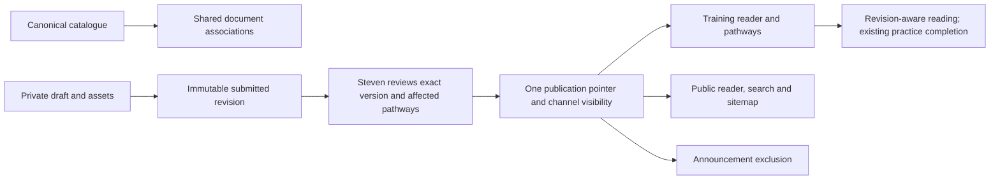

# Training 2.0 whole-module implementation and rollout plan

## Release packaging privacy — 1 November 2026

Steven explicitly kept starter notes unpublished during the requested deployment.
Because GitHub is public, actual manuscript bodies and exercise/hint pathway
files are retained in ignored `.learning-content-packs/`, not committed or included
in release artifacts. The following content-file pointers denote private local
inputs. Public code retains metadata, loader/import controls and synthetic fixtures.

## Local implementation status — 1 November 2026

The whole-module code and unreviewed starter packs have been implemented locally.
See [implementation evidence](../validation/training-2-implementation.md) for
behavior, verification and remaining release qualification. The checkboxes below
retain their original end-to-end acceptance meaning: target PostgreSQL evidence,
Steven/coach content decisions, learner evaluation and production release are not
marked complete by local implementation. No public content or production state
was changed.

## Assessment → Community → Training release baseline — 1 November 2026

The coordinated order is Assessment, then Community, then Training. Assessment
PR #398 (`ae895563`) adds `solutions.0011_problem_evaluation_packages` and
`solutions.0012_synthetic_review_prototype`; both must be applied before Training.
Preserve Assessment and Community source, privacy, public-proof visibility, schema
and AI-off controls. This order grants no AI activation, provider use, funded policy
or access. Community uses `pages.0045_community_proof_library`; the Training
prerequisite
migration is now `pages.0046_prerequisitegraphstate_catalogueprerequisite`.
Training still adds four migrations and 20 new tables, with 95 historical migration
sources frozen against the Assessment-and-Community-qualified baseline.

If the healthy Community data-class release is not rollback-eligible, qualify it
through the ordinary protected `none` release before attempting the Training bridge.
The strict bridge gate requires that actual active eligible baseline; never flip
an eligibility flag or invent a recovery target. The exact hard-off bridge defers
only prerequisite 0046, learning 0001/0002 and training 0006 without DDL or fake
migration records. The schema successor then requires that real, verified bridge
as its eligible compatible recovery baseline.

Earlier PostgreSQL reports retain their historical prerequisite 0045/92-source
claims. Any executed 93-source baseline reports remain historical as well. Fresh
Assessment/Community-preservation and Training proof for the 0046/95 baseline
is pending until the exact qualified release/source identities are bound to the
actual rehearsal and packaged evidence. Do not reuse the earlier proof as approval
of this changed baseline. See the [current release sequence](../deployment/training-2-bootstrap-recovery.md).
The 103 starter manuscripts and their local review ZIP remain private and outside
Git. Their source bytes do not change with this software migration renumbering.

## Overview and Scope

Redesign the whole Training module for **Algebra, Geometry, Number Theory,
Combinatorics, and the cross-topic Foundations pathway**. The shared platform covers
all 45 canonical areas and all 1,109 distinct canonical concepts; Foundations is a
first-class learning experience rather than a fifth catalogue subject. Mathematics
stays in `pages`, reusable teaching content in a bounded new `learning` app, curricula
and activity in `training`, and public reading adapters in `website`.

**Inequalities and optimization (`Algebra:inequalities`) is milestone M1, the first
pilot, rather than the endpoint of this plan.** M2–M4 assign every remaining area to
a concrete rollout wave, and M5 checks whole-module completion. Shared authoring,
review, assets and publication support every subject from M0; no permission check,
editor or content model is hard-coded to Algebra or Inequalities.

This expands the plan in place following Steven's whole-module scope instruction
on 1 November 2026. The historical filename is retained to preserve existing links.
The plan describes implementation and rollout work; it does not execute deployment,
protected configuration, content migration/publication or external messages.

The confirmed policies are Steven-only approval/publication, authors retaining
rights with permission for AsterProof publication, and one shared published revision
per document. See origin: `docs/brainstorms/2026-11-01-training-lecture-library-requirements.md`.

Pilot teaching audience: approved introductory/intermediate olympiad learners
comfortable with elementary algebra and nonnegative real numbers. Steven selects
the actual cohort before launch; no new accounts or access grants are implied.
Prepare an area overview, AM-GM and Cauchy-Schwarz concept explanations, and three
substantial lectures: AM-GM assumptions/proof/equality, Cauchy-Schwarz with Engel
applications, and recognising/choosing an inequality. The last lecture links to
`am-gm`, `cauchy-schwarz`, and `engel` without duplication. Keep `weighted-am-gm`
separate and use it for further exploration where appropriate. These are authoring
briefs, not generated or already approved lessons. Practice uses verified existing
problem UUIDs and reviewed original hints; unknown sources/permissions block release
of that material rather than invite copied solutions.

Explore covers the entire four-topic catalogue, including the pilot area's 33
concepts, from the shared-platform milestone. Learn gains complete introductory
pathways for all four topics and a full Foundations starter pathway during M2,
then additional area sequences in M3–M4. Preserve existing Foundations access during
the transition; preservation alone does not complete its new pathway deliverable.
Only useful reviewed content is exposed publicly. Module completion does not mean
1,109 lectures: catalogue discoverability, usable area learning packages, and deep
concept-note coverage are measured separately.

No mastery engine, AI calls, collaborative CRDT, PDF redesign, open licence, website
builder, new frontend framework, bulk shallow-note generation, external storage
service or newsletter activation is included. All previous privacy, ownership,
rights, revision, recovery and legacy-preservation decisions apply to every wave.

## Requirements Trace

| Origin requirements | Implementation units | Acceptance focus |
| --- | --- | --- |
| R1, R2 | U6, U7, U8 | Canonical IDs/aliases; distinct counts; Learn/Explore; unknown and empty states |
| R3, R15, R16 | U2, U4, U6, U8 | Reusable multiconcept documents and canonical pages; explicit standalone type |
| R4, R5, R14 | U3, U4 | Markdown/LaTeX, autosave, clipboard assets, mobile/keyboard and existing editor parity |
| R6, R7, R8 | U2, U5 | Immutable review snapshots, exclusive publisher, conflict recovery, exact approval |
| R9, R10, R11 | U3, U5, U8 | Common published revision; explicit channels; protected history/media; withdrawal |
| R12, R13 | U1, U7, U9 | Legacy identity, records and points preserved; reading distinct from practice/mastery |
| R17 | U6 | Curated prerequisite DAG, serialised edits and redirect-aware invalidation |
| R18, R19 | U4, U7 | Teaching templates, curated practice/hints, pathway context and revision provenance |
| R20 | U3, U9 | Asset validation, access, storage failure, reuse and retention |
| R21, R22 | U2, U5 | Private issue intake, classification suggestions, revision-bound rights and credits |
| R23 | U5, U8, U9 | Discovery-level announcement exclusion; unrelated campaigns preserved |
| R24 | U1–U9, M1 | Qualify the complete Inequalities pilot before content expansion |
| R25 | U10–U13, M0–M5 | All four topics, complete Foundations starter pathway, all 45 areas assigned and accepted |

## Whole-Module Rollout Milestones

The following is the delivery roadmap for the entire module, not an optional
post-pilot wish list. Milestones are dependency-based; calendar dates depend on
actual authorship, review capacity and learner evaluation. Area-wave order is an
editorial delivery priority, not a claim that every concept in that area has the
same difficulty or that the catalogue defines prerequisites.

| Milestone | Deliverable | New areas / cumulative | Exit gate |
| --- | --- | ---: | --- |
| M0 — Shared module | U1–U8 build one engine; all four subjects and Foundations appear in Learn/Explore with honest content states | 45 discoverable; no new area claimed taught | Subject-independent authoring/review/publication, full inventory, synthetic parity in all subjects, legacy/Foundation access intact |
| M1 — First pilot | Inequalities and optimization; U9 qualifies complete author → Steven → learner/public flows | 1 / 1 | All origin pilot scenarios, exact revision/media parity, practice/hints, educational review and release readiness pass |
| M2a — Foundations | U10 delivers the complete nine-competency starter pathway, with reusable notes, practice and cross-topic links | Cross-topic pathway; excluded from the 45-area total | All nine competencies have usable learning entries, shared identities and reviewed readiness/learning order |
| M2b — Algebra core entry | Equations, polynomials, sequences and shared proof strategies | 4 / 5 | Each area meets the area package gate; Inequalities and Foundations links work without copied notes/awards |
| M2c — Geometry core entry | Euclidean foundations, triangles, circles, metric/area methods and transformations | 5 / 10 | Reviewed assumptions/configurations and accessible, persistent diagrams; practice path passes |
| M2d — Number Theory core entry | Divisibility, congruences, Diophantine work, arithmetic functions and shared methods | 5 / 15 | Integer/domain/modulus restrictions and descent/parity recognition are explicit; practice path passes |
| M2e — Combinatorics core entry | Counting, processes/invariants, graph basics, colouring/tiling and games | 5 / 20 | Finite-set/model assumptions, constructive arguments, examples and hints reviewed; practice path passes |
| M3 — Extended coverage | U12 adds the next areas in all four subjects | 17 / 37 | Every listed M3 area has an accepted entry package; cross-area reuse and prerequisite/pathway checks pass |
| M4 — Specialist coverage | U12 delivers all remaining areas, with explicit audience/readiness | 8 / 45 | Every listed M4 area accepted, including specialist topics; none is silently dropped or represented by empty placeholders |
| M5 — Whole-module acceptance | U13 verifies all four topics, all 45 area entries and Foundations end to end | 45 / 45 plus Foundations | Scope audit complete, cross-topic regression/learning tasks pass, legacy continuity and selected public releases verified |

Cumulative numbers are accounting checkpoints, not a mandatory sequential lock
between M2b–M2e. Those topic streams may proceed in parallel after M1 qualification
and the Foundation skills they actually require. An M3/M4 area may start once its
relevant reviewed dependencies are ready; the milestone is complete only when all
its assigned areas pass. Drafting later material may start earlier without making
it published or implying milestone completion. Actual pedagogical prerequisite
edges still require the separate curator process.

### Per-Area Package and Release Gate

Every area's accountable editor is Steven for the initial plan; contributors may
prepare its material. Each area receives a versioned manifest with canonical ID,
milestone, audience, reviewed legacy mappings, document/revision and practice UUID
references, readiness needs, rights/credit evidence, acceptance results and explicit
Training/public release status. Per-area status distinguishes Planned, Drafting,
Ready for review, Training accepted and Public released. The manifest records scope
and evidence; it cannot grant authority or automatically publish anything.

An area meets its learning-package gate when it has an approved contextual overview,
at least one substantive original or reused teaching unit about representative
mathematical content in that area, and a usable pathway
segment from objectives/assumptions through proof or method, worked example and
verified practice/hints. Reuse is preferred when it serves the same audience; a
different explanation may warrant a separate document. Document count is not the
goal. The overview clearly identifies covered concepts, advanced/outstanding
material and relevant Foundations links. Empty concept pages and upload-created
drafts count as neither teaching coverage nor completion. Public navigation exposes
only the reviewed useful subset, not every internally listed concept.

Each area also repeats permission/privacy, paste-save-reopen/read, stale revision,
legacy-link/progress, shared-reference and zero-unintended-announcement checks.
Review the effect on earlier pathways before changing a reused document. A later
placement may reuse already public content, but must not implicitly release its
unreviewed overview, pathway hints, drafts or other linked documents.

Report three separate measures: (1) canonical catalogue discoverability, (2) accepted
area/pathway packages, and (3) distinct concepts with useful approved teaching
content. Shared concepts and documents count once in unique totals. M5 requires
all 45 area packages and Foundations to be accepted for Training and their intended
public entry content deliberately released. A withheld/public-pending area remains
visible on the rollout checklist as pending, rather than being declared fully
released. Comprehensive notes for all 1,109 concepts are an ongoing depth backlog;
this plan does not falsely claim that milestone M5 supplies all of them.

### Foundations Deliverable

Deliver all nine existing seed competencies in a first-class Foundations Learn
pathway: mathematical proof-writing, mathematical induction, extremal principle,
WLOG/symmetry arguments, parity arguments, constructive proofs, bounding/estimation,
relations/equivalence classes, and ordered structures. Use a progressive core route
and clearly marked optional branches appropriate to audience/readiness rather than
requiring every beginner to complete advanced order structures first.

Each competency needs a substantive teaching entry, proof/recognition/mistake cues,
worked example, practice/hint activity and links into relevant topic pathways.
Canonical anchors are reviewed against existing scoped IDs; similar labels do not
authorise merging distinct concepts. Reuse notes between Foundations and Algebra
shared strategies, Number Theory shared methods and Combinatorics processes where
the canonical identity and teaching purpose agree. Preserve legacy Foundations
material, completions and URLs through verified bridges. A prominent legacy link
alone does not satisfy M2a, and Foundations adds no synthetic catalogue subject or
extra area to the 45-area total. Its approved public introductory notes use the same
publication system; private learner progress remains private.

### Exact Area Assignment

This checklist uses the checked seed; U1 reconciles target catalogue drift before
execution. Exact historical IDs are retained, including spaces in Combinatorics keys.
Every current area appears exactly once. Foundations is accounted for separately.

| Topic | Canonical area ID | Area | Milestone |
| --- | --- | --- | --- |
| Algebra | `Algebra:inequalities` | Inequalities and optimization | M1 |
| Algebra | `Algebra:equations` | Equations, substitutions, and transformations | M2b |
| Algebra | `Algebra:polynomials` | Polynomials and algebraic manipulation | M2b |
| Algebra | `Algebra:sequences` | Sequences, recurrences, and summation | M2b |
| Algebra | `Algebra:shared` | Shared proof strategies | M2b |
| Algebra | `Algebra:analytic` | Complex, trigonometric, and analytic tools | M3 |
| Algebra | `Algebra:discrete` | Discrete functions, rounding, and finite dynamics | M3 |
| Algebra | `Algebra:functional` | Functions and functional equations | M3 |
| Algebra | `Algebra:linear` | Linear algebra and quadratic forms | M3 |
| Algebra | `Algebra:structures` | Algebraic structures and finite fields | M4 |
| Geometry | `Geometry:metric` | Area, metric identities, and inequalities | M2c |
| Geometry | `Geometry:circles` | Circles, tangency, and cyclicity | M2c |
| Geometry | `Geometry:foundations` | Euclidean foundations and methods | M2c |
| Geometry | `Geometry:transformations` | Transformations and symmetry | M2c |
| Geometry | `Geometry:triangles` | Triangle centers and configurations | M2c |
| Geometry | `Geometry:coordinates` | Coordinates, vectors, and trigonometry | M3 |
| Geometry | `Geometry:discrete` | Discrete geometry and constructions | M3 |
| Geometry | `Geometry:locus` | Loci, continuity, and geometric motion | M3 |
| Geometry | `Geometry:projective` | Projective, affine, and conic geometry | M4 |
| Geometry | `Geometry:solid` | Spatial and spherical geometry | M4 |
| Number Theory | `Number Theory:arithmetic-functions` | Arithmetic functions and divisor structure | M2d |
| Number Theory | `Number Theory:congruences` | Congruences, orders, and modular arithmetic | M2d |
| Number Theory | `Number Theory:diophantine` | Diophantine equations, descent, and representations | M2d |
| Number Theory | `Number Theory:divisibility` | Divisibility, primes, and factorization | M2d |
| Number Theory | `Number Theory:shared` | Shared objects and proof strategies | M2d |
| Number Theory | `Number Theory:additive` | Additive and multiplicative combinatorics | M3 |
| Number Theory | `Number Theory:digits` | Bases, digits, carries, and automata | M3 |
| Number Theory | `Number Theory:residues` | Power residues and quadratic characters | M3 |
| Number Theory | `Number Theory:approximation` | Rational approximation, floors, and fractional parts | M3 |
| Number Theory | `Number Theory:valuations` | Valuations and p-adic methods | M3 |
| Number Theory | `Number Theory:algebraic` | Algebraic number theory | M4 |
| Number Theory | `Number Theory:structures` | Finite fields, lattice methods, and arithmetic dynamics | M4 |
| Combinatorics | `Combinatorics:Coloring, grids, tilings, and dissections` | Coloring, grids, tilings, and dissections | M2e |
| Combinatorics | `Combinatorics:Counting and enumeration` | Counting and enumeration | M2e |
| Combinatorics | `Combinatorics:Games and adversarial methods` | Games and adversarial methods | M2e |
| Combinatorics | `Combinatorics:Graph structures and graph arguments` | Graph structures and graph arguments | M2e |
| Combinatorics | `Combinatorics:Processes, invariants, and shared proof methods` | Processes, invariants, and shared proof methods | M2e |
| Combinatorics | `Combinatorics:Algebraic and linear methods` | Algebraic and linear methods | M3 |
| Combinatorics | `Combinatorics:Algorithms, words, automata, and reconstruction` | Algorithms, words, automata, and reconstruction | M3 |
| Combinatorics | `Combinatorics:Matching, covering, packing, and optimization` | Matching, covering, packing, and optimization | M3 |
| Combinatorics | `Combinatorics:Probability, entropy, and coding` | Probability, entropy, and coding | M3 |
| Combinatorics | `Combinatorics:Set systems, orders, and designs` | Set systems, orders, and designs | M3 |
| Combinatorics | `Combinatorics:Additive combinatorics` | Additive combinatorics | M4 |
| Combinatorics | `Combinatorics:Combinatorial geometry and topology` | Combinatorial geometry and topology | M4 |
| Combinatorics | `Combinatorics:Extremal combinatorics, Ramsey theory, and discrepancy` | Extremal combinatorics, Ramsey theory, and discrepancy | M4 |

Area accounting: Algebra 10, Geometry 10, Number Theory 12, Combinatorics 13;
M1 1 + M2 19 + M3 17 + M4 8 = 45. Foundations is a cross-topic pathway.

## Context and Research

Source inspection is against local HEAD `0f3ad3a46734a51b757bbfb2d3fdc3276a25cfaf`.
This is not a fresh assertion about GitHub main, deployed code, content volume,
owner identity or live newsletter state. Phase U1 verifies the target-specific facts.

- Stack: Django 5.1.9, Python >=3.12 (CI 3.12.4), PostgreSQL 17.9 rehearsals,
  Markdown 3.10.2, Bleach 6.3.0, Pillow 11.2.1; CodeMirror 6, MathJax 3.2.2,
  Inspinia/Bootstrap and Gulp/esbuild. Sources: dependency manifests and CI.
- `inspinia/pages/catalogue_models.py`, `catalogue_browser.py`,
  `catalogue_snapshots.py`: canonical identity, many-area membership, redirect
  resolution, paginated navigation and off-request derived problem memberships.
- `inspinia/solutions/revisions.py`, `models.py`, `sharing.py`: signed ownership
  context, optimistic versions, immutable revision guards, deterministic locks and
  source/metadata-bound sharing. Reuse patterns, not solution ownership or broad
  administrator permissions.
- `inspinia/users/roles.py` admits generic superusers as app admins. New publisher
  checks must be separate. `RequireApprovedUserMiddleware` exempts `/library/`;
  each private learning view still needs explicit authentication and app-access checks.
- `config/settings/production.py`: files under `MEDIA_ROOT` are directly served.
  `training/markdown.py` excludes image tags. Existing clipboard JavaScript and
  existing image URLs cannot deliver private lecture media unchanged.
- `training.Problem` is different from `pages.ProblemSolveRecord`; no label-based
  conversion may invent a canonical UUID link. Current materials, awards and
  submissions retain their original foreign keys.
- `website/views.py`, `seo.py`, `automation.py`: current editorial hierarchy,
  publication-aware queries and independent discovery of newly public lectures.
- `scripts/ci_checks.py` hardcodes known apps; a new app needs explicit inclusion.
  CI/schema release dispatch is also explicit; migration-free deploy cannot apply
  this pilot's schema automatically.

Relevant learnings: `docs/solutions/continuous-solution-editor.md` preserves editor
identity and separates saves from sharing/completion;
`docs/solutions/public-solution-sharing.md` binds the full review context and
reconciles ambiguous actions; the pasted-image incident in
`docs/solutions/integration-issues/solution-pdf-export-missing-body-images-2026-03-29.md`
requires testing persistence through downstream readers, not just preview.
`docs/deployment/solution-document-editor.md` describes frozen reader capabilities;
changing guarded solution sources needs refreshed compatibility evidence.
No lecture-private-asset or prerequisite-DAG implementation already exists.

Official references shaping decisions: Django's [storage API](https://docs.djangoproject.com/en/5.1/ref/files/storage/),
[FileResponse](https://docs.djangoproject.com/en/5.1/ref/request-response/#fileresponse-objects),
[locking caveats](https://docs.djangoproject.com/en/5.1/ref/models/querysets/#select-for-update),
[transactions/on_commit](https://docs.djangoproject.com/en/5.1/topics/db/transactions/#performing-actions-after-commit),
and [CSRF AJAX guidance](https://docs.djangoproject.com/en/5.1/howto/csrf/#using-csrf-protection-with-ajax).
SQLite does not prove row-lock behaviour. Filesystem writes are not rolled back
with database transactions. Post-commit cache failure cannot undo publication.
Use PostgreSQL transaction tests and authoritative database visibility accordingly.
[OWASP upload](https://cheatsheetseries.owasp.org/cheatsheets/File_Upload_Cheat_Sheet.html)
and [XSS guidance](https://cheatsheetseries.owasp.org/cheatsheets/Cross_Site_Scripting_Prevention_Cheat_Sheet.html)
shape controlled raster uploads and a single sanitisation boundary.
[RFC 9110](https://www.rfc-editor.org/rfc/rfc9110.html#section-9.2.2) informs mutation
receipts and reconciliation instead of blind POST replay.
MathJax's version-specific [safe-extension guidance](https://docs.mathjax.org/en/v3.2/options/safe.html)
also matters: sanitising Markdown HTML alone does not constrain attributes generated
later by TeX macros. Learning surfaces need a restricted mathematics policy.

## Technical Decisions

### 1. Bounded ownership and additive coexistence

Create `inspinia/learning` for documents, author drafts, immutable revisions,
concept/asset references, proposals, rights receipts, publication state, content
issues and audit/action receipts. Keep pathways/activity in `training`, and canonical
prerequisite curation in `pages`. This has two present reading consumers and its own
ownership lifecycle; it is not a generic CMS or polymorphic content framework.

Use explicit relational references for searchable concept/asset associations and
fixed metadata snapshots for revision-bound captions, credits, audience and rights.
A document UUID is stable; authorship belongs to contributions, not exclusive
ownership of the shared document. One active draft per author/document is sufficient
for the pilot. A contributor may branch from the current published revision;
checkpoint history is append-only. Restoring history creates a new private draft.
Model/queryset immutability guards, protected references and absent mutation admin
surfaces protect supported app operations; they are not claims against arbitrary
privileged database operators.

New canonical landing records have exactly one required area or concept identity,
with a unique canonical landing per target; standalone editorial material has an
explicit kind. Do not instantiate landing records for all 1,109 concepts. Different
explanations for a concept are resource documents linked to that identity.

Use a typed `LegacyContentLink` bridge for the four known legacy targets: Training
material and public area/concept/lecture. Exactly one source FK, reviewed source
fingerprint, target document and explicit cutover state prevent ambiguous mappings.
Create its migration after the new content foundation and existing legacy schema;
keep learning's foundational migrations independent of new pathway migrations to
avoid circular app dependencies. Do not add generic content-type routing.
Require database uniqueness for each non-null legacy source, not just the one-source
check. Protect cutover mappings, retained revisions and referenced assets from
cascading deletion. Contributor-account deletion cannot remove a published document
or its provenance; nullable author references and any retained attribution follow
the reviewed privacy/rights procedure. Retirement is an explicit reviewed state
transition, never deletion that silently re-enables a legacy reader.

Uncutover legacy records use their current readers and permissions. A cutover reader
uses the common publication resolver; it must never fall back to stale legacy body
text when the new document is withdrawn/private. Legacy private content is not
backfilled as public. Existing published legacy content can remain on its old reader
until its explicit reviewed cutover; titles alone never establish a mapping.

### 2. Authority, rights and exact revisions

Use a learning-specific predicate backed by a single verified existing stable user
PK setting, `LEARNING_PUBLISHER_USER_ID`, default unset/fail-closed. Check active
identity and approved app access; do not match name/email, create a privileged
account, reuse `user_has_admin_role`, or allow a user-editable flag. Production
binding is a private activation fact, not an identifier committed to this plan.
Approval, publication, replacement, withdrawal, cutover and curator mutation services,
and their HTTP/admin adapters, enforce this predicate. Contributor saves, checkpoints,
uploads and submissions instead require approved app access and ownership. Anonymous
reports use their separate current-public-target and abuse checks. New learning model
admin is inspection-only: no publication, bridge, rights or revision mutation forms.

Submission freezes source/format, metadata, primary/supporting concept links,
asset references/descriptions/permissions, opt-in credit, agreement version and
contributor permission evidence. Rights remain with authors. No blanket licence
is inferred for third-party diagrams, problems or existing notes. New editorial
checkpoints preserve original authorship; approval requires permission covering
the resulting version. If editorial changes exceed an existing grant, return for
permission rather than silently transferring authorship or approving anyway.

The contributor UI shows the selected rights-retained agreement and a public-credit
choice (chosen credit or no personal credit), with no default account-name disclosure.
Agreement text, withdrawal procedure and applicable young-contributor authorisation
are launch prerequisites. Use synthetic agreement fixtures for local checks; keep
production submission closed until that version is explicitly ready. No age threshold
or guardian authority is guessed from a profile or account approval.

### 3. Publication, concurrency and channels

A `ContentPublication` row has one current revision, independent Training/public
visibility flags and a monotonically increasing version. Public visibility implies
Training visibility across the module. Approval alone changes neither visibility nor
the current published pointer. Publish, replace, withdraw and restore are explicit
state-changing actions. Withdrawing public visibility need not remove internal
Training access; removing all visibility does. Neither exposes history anonymously.

Use signed contexts bound to actor, draft/document and expected edit/publication
versions. Every mutation has an operation UUID, actor/target and payload digest;
persist its outcome in bounded content action records. An identical already-completed
operation returns its recorded outcome; mismatched reuse fails. A lost response is
resolved by an authorised receipt/status read before redispatch. An old operation
receipt does not bypass a later version check for a new action.
Keep the most recent 64 autosave receipt identities/digests with the working draft;
an expired receipt requires state reconciliation and cannot replay a stale save.
Checkpoint, review and publication action facts are durable. Do not create permanent
full-source history for every debounced autosave.
Bound server-side authoring as well as browser debouncing: initially 25 active
drafts per author, 60 autosaves and 120 previews per minute per author, and 10 image
upload attempts per minute per author with a 200/day pilot-wide accepted-upload cap.
Use the existing trusted-source/HMAC cache pattern, fail closed on limiter failure,
and preserve the user's text when throttled. These are adjustable pilot defaults,
not permission to increase resource use or change solution limits.

Submission/review digests include affected pathway versions, canonical association
state and rights/asset versions. Publication locks the reviewed dependencies in a
consistent order, rechecks versions/digests and permissions, and commits pointer,
visibility, audit and distribution exclusion atomically. No network/file fetch
occurs while holding publication locks. If a dependency changed, preserve the
proposal and require a fresh comparison/approval. Preview names all affected
placements; audience/assumption/readiness changes require pathway reconciliation
before replacement. A different audience may warrant a distinct document, not a
second channel-specific revision of the same document.

Close phantom references as well as updates to existing rows: every supported
pathway/placement writer locks its referenced documents as stable parents before
changing links. Publication recomputes its impact set under those same parent locks.
Use a consistent order: newsletter policy when needed; catalogue/graph guards;
document UUIDs; pathway/placement IDs; proposal, rights and
asset IDs. All multi-target writers sort within each class and never acquire an
earlier class after a later one. Test new pathway insertion during an audience-changing
publication, not only updates to a pathway already in the reviewed set.

Public queries, search, counts, sitemaps and asset access use the same resolver.
Initially return private/no-store responses, even for public note/media responses,
so application caches cannot retain revoked text. Optional future caching must be
publication-version keyed and recheck visibility. `on_commit` invalidation improves
freshness but is not the access-control boundary. Never use a permanent redirect
whose cached target could reveal a withdrawn document's title or content.

### 4. Assets and mathematical rendering

Choose private filesystem storage outside release directories, static roots and
`MEDIA_ROOT`, at `LEARNING_PRIVATE_ASSET_ROOT`. Authorised Django delivery checks
the current request and publication/revision references before bounded FileResponse.
Do not add S3, public file URLs or proxy configuration for the pilot. Verify path
ownership and persistence at activation; preparing a new protected host directory
or changing runtime settings requires its reviewed action-specific authorisation.
Missing configuration leaves uploads/intake disabled rather than falling back to
public media. Private draft assets are author-only; submitted-reference assets are
available to that author and Steven. Approved workspace readers can access assets
referenced by a current Training-visible revision; anonymous access requires a
current public revision. These grants derive from the exact current publication,
not from an old revision. A privately retained revision grants no public access.

Initial technical bounds: 64,000 source characters; PNG/JPEG/static WebP only;
3 MiB uploaded/output bytes and 16 million decoded pixels per image; at most 20
referenced images per document and 100 MiB retained upload bytes per author. These
are pilot resource defaults, not limits imposed on existing solution uploads.
Verify integrity, reopen/decode, reject animation and decompression-bomb warnings,
normalise orientation and remove unnecessary embedded metadata on re-encoding.
Use opaque generated names, correct MIME and nosniff. Enforce bounds before expensive
processing and during output generation; recheck quota during acceptance of races.

Use controlled Markdown asset destinations such as an opaque `asset:<uuid>` token,
resolved only from validated revision/draft references. Disallow arbitrary image
URLs, raw image HTML, SVG uploads and remote fetching. Shared asset references need
explicit authorised reuse, not possession of an ID. Process all generated elements,
links, captions, alt text, titles and diff output through one sanitisation contract;
MathJax renders text mathematics, not untrusted HTML. Private preview and public
reading use the same renderer with different reference-authorisation contexts.
On learning surfaces disable author-controlled TeX HTML/link/style commands and
runtime extension loading; unsupported commands produce a harmless source/preview
error rather than markup. Configure the pinned engine's safe component restrictively
as additional protection, not proof that arbitrary TeX is safe. Test unsafe/encoded
URL schemes and attribute-producing macros after typesetting as well as before it.
Keep this policy scoped to learning and verify shared-loader regressions; any needed
engine/dependency upgrade must be separately identified rather than assumed here.

Asset bytes are immutable after acceptance; revision associations carry immutable
alt/credit/caption metadata. Stage uploads privately and record durable ownership
before referencing them. Database failure may leave a private orphan: no success
response and no public access. Cleanup is an explicit bounded maintenance command,
not request-time deletion or a new timer: dry-run manifest first, then only unreferenced
staged/orphaned files older than seven days. Reference creation and cleanup use the
same asset-row lock and state protocol. Cleanup rechecks references under that lock,
commits a deleting/tombstone state, then unlinks outside the transaction; reference
creation refuses a deleting asset. An unlink failure retains the tombstone for
idempotent cleanup/reconciliation, never reports reusable bytes. Retain assets
referenced by any checkpoint, submission or publication. Draft deletion cannot
remove such files; withdrawal revokes public access unless another current public
revision independently authorises it. Missing files block publication with a clear
error; a missing image in a previously published note is recorded as an operational
fault, not silently replaced with unapproved content.

### 5. Knowledge and pathway separation

Use an additive `CataloguePrerequisite` relation and small serialised graph-state
record in `pages`. This preserves the frozen narrower/related table and avoids
reinterpreting catalogue navigation. Direction is prerequisite → dependent.
Steven approves edges through the dedicated curator service, separate from content
approval. Resolve redirects, reject self/cycles, lock the graph state for the whole
validation/update, and use expected graph versions. Concurrent reciprocal edits
cannot both succeed. Content issues may suggest edges; they never apply them.

There is no current canonical merge editor to extend. Unexpected catalogue changes
invalidate prerequisite validation through the existing catalogue revision marker.
The existing off-request maintenance path revalidates and records the graph state;
GETs display prerequisites as temporarily unavailable rather than rebuild or use
an invalid graph. A later supported rename/merge operation must validate the effective
DAG before committing. Existing narrower/related semantics and problem-assignment
validation remain intact; no universal prerequisite is inferred from a tag.

`LearningPath`, immutable `LearningPathRevision` and ordered snapshot items live in
`training`. Items reference a shared document, a canonical problem UUID, or a verified
legacy material mapping. Curated hints/readiness/order belong to the path revision;
shared document text stays in learning. Keep a stable item identity across path
revisions, and record the exact path/document revisions for learning activity.
Opening a document is only a transient encounter, not completion. An explicit
**Mark as read** action records a revision-bound, self-reported reading completion;
it is idempotent and awards no points. Preserve Read earlier revision only when
the learner explicitly marked that revision; a view alone never becomes that state.
Persist learning provenance with explicit activity actions, not a new page-view
surveillance stream. Learning GET/HEAD creates no drafts, activities, reports or
receipts. Practice completion reads existing canonical completion authority;
opening a problem does not become an attempt or solve. Legacy MaterialCompletion
and PointLedger remain authoritative for old materials, without copied award rows.

The pilot uses a small Steven-owned pathway editor/preview, not a generic course
builder. Trainers can submit version-bound private pathway suggestions through the
issue queue; Steven incorporates and approves a new path revision. Preserve return
navigation/Next activity from Learn and topic/area context from Explore through
allowlisted internal identifiers, not arbitrary return URLs. Readiness is advice,
not an access lock. Include spaced review activities and progressively disclosed
hints where appropriate, without a scheduler or reminder service.

### 6. Public adapters and distribution

Add stable website-owned note permalinks under `/library/notes/<uuid>/<slug>/` before
generic subject routes. The UUID is identity; preserve initial published slugs as
aliases and direct old nested URLs through verified bridge records. Public titles,
credits and social metadata come only from the approved revision. Do not put private
review routes beneath a blanket public middleware exemption. Keep private authoring
under `/learning/` and new Learn/Explore routes before legacy dynamic Training routes.

New shared lectures in any topic do not create duplicate `LibraryLecture` rows for each placement.
They remain outside legacy newsletter discovery. When an existing lecture is bridged
or cut over, store the bridge's announcement exclusion before exposure and teach
`public_lectures()` to exclude those mapped module rows before `_capture_lectures()`.
Do this in the publication/cutover transaction. Do not toggle the global automation,
change consent, or count a successful dispatch as inbox proof. New-app publications
have an explicit excluded announcement disposition from creation; no new discovery
path may opt them in by default. Test with an already enabled worker concurrently.
At legacy cutover, acquire the existing `NewsletterAutomation` policy lock before
the shared-document locks, matching discovery serialisation. Inspect prior notices:
exclude only the mapped lecture's still-pending notice in the reviewed transaction;
retain completed campaign history. An included active/in-flight campaign or unknown
send outcome blocks that cutover until its original operation is reconciled; do not
silently cancel, resend or claim a zero-exposure result. Require every relevant
reader and newsletter worker to run exclusion-aware code before enabling cutover.

### 7. Reader compatibility and paired recovery

Add a `learning_reader` capability to release manifests, checked against frozen
visibility-aware reader/bridge/media source bytes in a new
`scripts/deployment/learning_compat.py`. The build and installed worker verify the
artifact rather than trusting a candidate's own assertion. Choose the conservative
pattern already used for solution documents: installing the initial learning schema
establishes reader floor one, detected from the reviewed schema identity through
metadata-only audit. It applies even when content tables are empty and writes are
disabled, and cannot be lowered by withdrawal or a runtime publication action.
Any required trusted-authority installation is separately scoped; application code
cannot install its own enforcement.

After that floor, deployment, recovery and rollback target selection must reject
readers that could ignore a cutover and render old public Markdown. Schema-only
previous-reader smoke is not recovery eligibility. Prepare a verified compatible
recovery artifact before schema activation, then verify compatible active readers
and newsletter workers before enabling `LEARNING_PUBLICATION_ENABLED`, default off.
Use migration-safe guarded readers while tables are absent, and obey the existing
permitted recovery-target selection rules; if no compatible recovery artifact is
eligible, the schema release is not ready. Do not broaden recovery selection to make
it pass. Dormant schema work does not force immediate content activation. No
automatically invoked recovery may bypass the floor.

Floor establishment and final activation/recovery eligibility run within the existing
serialised deployment operation. Ordinary application publication never raises the
floor, avoiding a first-publication versus old-reader-activation race. Recheck the
schema-derived floor inside the final activation/recovery critical section and test
two competing operational selections as well as first-publication requests.

Recovery also needs a matching private asset set, not just database rows. Test a
synthetic paired restore with revision/asset IDs, immutable file hashes and a
manifest proving every restored published reference resolves. Record the recovery
owner/method for the production private root before activation. This plan does not
execute or extend production backup authority.

## High-Level Flow

This illustrates the intended approach and is directional guidance for review,
not implementation specification. The implementing agent should treat it as context,
not code to reproduce.

## Implementation Units

### U1 — Audit and preserve the baseline

- [ ] **Goal:** Produce a bounded, non-mutating mapping/preservation inventory before
  schema conversion. **Requirements:** R12, R13, R16, R24. **Dependencies:** none.

**Files:** Create `inspinia/learning/__init__.py`, `apps.py`,
`management/commands/audit_learning_pilot.py`, `tests/test_legacy_audit.py`;
modify `config/settings/base.py`, `scripts/ci_checks.py` and
`scripts/deployment/tests/test_ci_checks.py` for app discovery and dependent coverage.
Create `docs/validation/inequalities-pilot-audit.md` for a synthetic pilot example
and `docs/validation/training-module-audit.md` for the whole-module inventory.
The audit accepts an explicit area/subject scope or all areas; its historical
command name does not restrict it to Inequalities.

**Approach/patterns:** Inspect catalogue, legacy Training and website through their
owning models. Emit counts, stable IDs, mapping ambiguity and source fingerprints,
not private bodies, account records or credentials. No title-based autoapply,
get-or-create, point updates or publication changes. A production use must follow
an established diagnostic interface; a command labelled audit is not permission
for arbitrary remote command dispatch. Record unmapped Foundations and separate
Training problems explicitly. Include learning in CI app/dependent selection so
broad fallback cannot omit it.

**Tests:** Known unique mapping candidate is reported only; duplicate title yields
ambiguity; missing canonical/problem links stay unmapped; audit performs no DB writes;
private text/user details are absent from output; new-app/changed shared assets select
learning plus relevant training/website/solution tests. Audit all four subjects and
all nine current Foundations competencies, preserving exact area keys including
Combinatorics keys with spaces. Each of the 45 areas has a rollout owner/status entry.

**Verification:** A reproducible synthetic baseline and explicit unmapped list exist;
no source data or permissions have changed. Real mapping remains a later reviewed
input, not data invented to make the plan executable.

### U2 — Shared content, rights, revisions and authority

- [ ] **Goal:** Add the content domain and safe lifecycle before authoring access.
  **Requirements:** R3, R5–R9, R15, R16, R22. **Dependencies:** U1.

**Files:** Create `inspinia/learning/models.py`, `permissions.py`, `drafts.py`,
`revisions.py`, `publication.py`, `rights.py`, `legacy.py`, `admin.py`, and migrations
under `inspinia/learning/migrations/`. Tests: `inspinia/learning/tests/test_models.py`,
`test_permissions.py`, `test_revisions.py`, `test_publication.py`, `test_rights.py`,
`test_migrations.py`. Modify `config/settings/base.py`, `test.py`, `.env.sample`.

**Approach/patterns:** Implement the bounded entities/bridge and publisher predicate
above. Use distinct signed context salt and explicit app-access/owner checks. Add
`LEARNING_MODULE_ENABLED` and `LEARNING_CONTRIBUTIONS_ENABLED` gates, default off, with
local/test overrides, plus separately gated `LEARNING_PUBLICATION_ENABLED`. Initial
learning schema presence establishes the conservative reader floor; there is no
mutable runtime floor flag. New publication rows begin hidden and excluded from
announcements.
Keep graph/pathway migrations separate. Resolve actual migration names after rebasing,
not by assuming current leaf numbers. Follow solution revision transactions and
immutability patterns; do not change the custom User model or solution schema.

**Tests:** Approved learner owns only their draft; pending/anonymous/other author denied;
generic admin, trainer and superuser fail publisher checks; unset/inactive binding
fails closed. Identical save/checkpoint is not duplicate history; stale edit, expired
context, altered digest and operation-UUID reuse preserve source and reject mutation.
Consent/credit/asset-association changes require a new revision; grants do not expand
to unrelated content. Old app can read/write legacy records after the additive upgrade.
Duplicate bridges are rejected by constraints. Deleting a legacy source, revision,
or contributor account cannot cascade away a cutover/publication/provenance record
or restore legacy fallback; verify the explicit retirement policy instead.

**Verification:** Models and services pass isolated SQLite validation and PostgreSQL
transaction tests for lost response, concurrent duplicate/stale publication and atomic
rollback. Publication remains inaccessible through generic model admin or direct forms.

### U3 — Private assets and one safe renderer

- [ ] **Goal:** Make pasted images private, durable and publication-aware.
  **Requirements:** R4, R8, R10, R11, R14, R20. **Dependencies:** U2.

**Files:** Create `inspinia/learning/assets.py`, `storage.py`, `rendering.py`,
`asset_views.py`, `management/commands/cleanup_learning_assets.py`;
`inspinia/learning/tests/test_assets.py`, `test_asset_access.py`, `test_rendering.py`,
`test_asset_cleanup.py`. Modify `config/settings/base.py`, `test.py`, `.env.sample`;
add public media route in `inspinia/website/urls.py` through a thin adapter.
Create `inspinia/static/js/learning-math.js`,
`inspinia/templates/learning/partials/mathjax.html` and
`scripts/tests/learning_math.test.cjs` for the scoped mathematical rendering policy;
wire it through the existing loader and bundle build, without a second MathJax instance.

**Approach/patterns:** Dedicated private storage and controlled asset tokens, not a
widened global Markdown allowlist or reused solution image URLs. Authorised requests
return files with no-store/nosniff. Preserve semantic maths and sanitized prose.
No public storage URL is ever emitted in draft JSON. Retain referenced assets and
make missing files, quota exhaustion and transaction/orphan failure distinct errors.

**Tests:** Valid paste, malicious MIME/path, truncated/animated/oversized/pixel-bomb
images, cross-owner guessed ID, missing storage and concurrent quota consumption.
Assert author/Steven/guest access by draft/submitted/current/historical state; after
withdrawal or draft deletion verify both access and retained bytes, including an
asset legitimately reused by another current publication. XSS/link/caption/alt payloads
remain inert in preview, diff and reading. Cleanup cannot delete retained references
and never deletes a fresh racing upload. Race an old orphan's attachment against
cleanup on PostgreSQL: the shared lock/state protocol permits either an intact
reference or a rejected attachment, never a referenced missing file. Test failed
unlink and repeat cleanup against the tombstone. Public withdrawal with Training
retained still serves approved Training readers; withdrawing both channels does not.

**Verification:** Paste → save → reload → submit → publish → anonymous read works in
isolated integration fixtures, with correct alt/credit and no direct-public-path leak.

### U4 — Unified mathematical editor and contribution entry points

- [ ] **Goal:** Deliver private authoring without changing solution behaviour.
  **Requirements:** R3–R5, R8, R14, R18. **Dependencies:** U2, U3.

**Files:** Create `inspinia/static/js/math-document-editor.js`, `learning-editor.js`,
`inspinia/learning/forms.py`, `views.py`, `urls.py`, `templates.py`,
`inspinia/templates/learning/editor.html`, `my-drafts.html`, `partials/rights-credit.html`,
`inspinia/static/scss/components/_learning-editor.scss`. Modify
`inspinia/static/js/solution-document-editor.js`, `gulpfile.js`,
`inspinia/static/scss/app.scss`, `inspinia/templates/partials/sidenav.html`,
`config/urls.py`. Tests: `inspinia/learning/tests/test_editor.py`,
`scripts/tests/learning_editor.test.cjs`, `scripts/tests/test_learning_editor_js.py`;
extend existing document core/clipboard/recovery and solution editor tests.

**Approach/patterns:** Extract only reusable CodeMirror completion/selection/paste
utilities; keep solution controller, LaTeX renderer, recovery and PDF contracts.
Use existing packages for the initial Markdown source surface; syntax-highlighting
polish is not a reason to add an editor framework/dependency. Debounce learning's
server-rendered preview and autosave separately, reject stale preview responses,
show saved versus checkpointed/submitted status. Include textarea/form fallback,
mobile source/preview modes and Ctrl/Cmd-S checkpoint. No AI or automatic public save.
Templates supply meaningful section prompts, not forced empty headings. Add read-page
Edit/Suggest actions and clear new-note/correction/report choices.

**Tests:** Synthetic authoring works with canonical targets from all four subjects
and with Foundations context, without an Inequalities-only allowlist. Autosave
failure/offline recovery, expired login/context, reverse-order
preview responses, image insertion while cursor/text changes, submit during upload,
keyboard/mobile modes and no-JS form save. Switching accounts cannot restore another
user's local draft. Existing solutions retain paste, undo, completion, PDF saved-source,
share snapshots and public Writer/handoff behaviour.

**Verification:** Focused JS/Python regressions and synthetic desktop/mobile browser
journeys pass; shared assets rebuild successfully during implementation. No browser
preview claims are made by this planning document.

### U5 — Review, publication and private issue intake

- [ ] **Goal:** Enforce the complete editorial decision at every entry point.
  **Requirements:** R6–R11, R21–R23. **Dependencies:** U2–U4.

**Files:** Extend `inspinia/learning/publication.py`, `views.py`, `urls.py`;
create `review.py`, `issues.py`, `inspinia/templates/learning/review-queue.html`,
`proposal.html`, `publication-preview.html`, `issue-form.html`, `issues.html`.
Modify `inspinia/website/automation.py` for bridge exclusion.
Tests: `inspinia/learning/tests/test_review.py`, `test_issues.py`, `test_publication.py`,
`inspinia/website/tests/test_automation.py`, `test_automation_migration.py`.

**Approach/patterns:** Exact-version text/metadata/assets/rights/impact comparison;
changes requested and decline preserve history. Publisher editing creates an
attributed checkpoint and new approval. Publish/cutover sets excluded announcement
state before visibility; discovery honours the bridge. Classifications/pathway
suggestions enter a private queue, never automatic catalogue edits. Mirror the
bounded statement-report pattern: 2,000-character plain text, no files/email,
CSRF and signed replay token, honeypot, 10/hour per trusted-source HMAC and 100/day
pilot-wide report allowance, fail-closed cache errors. Anonymous target must be current-public;
unknown/private/withdrawn targets disclose nothing. Only Steven sees reports.

**Tests:** Source identical but credit/rights/asset/pathway changed invalidates review;
stale approvals and simultaneous publish/withdraw cannot silently win. No HTTP/admin
bypass for generic roles. Lost responses resolve via receipt. Anonymous report replay
creates one row; cache outage/rate failure rejects without exposure. Run concurrent
enabled newsletter discovery while first publishing, replacing and cutting over a
pilot note: no pilot pending notice/send; unrelated notices/consent stay intact.
Test pre-existing pending and included/in-flight notices as well as first discovery;
cutover must refuse an unreconciled active delivery rather than cancelling it.

**Verification:** Revision approval, actual public visibility and announcement state
are distinct, auditable facts. The exact contributor agreement remains a launch gate,
not an invented legal conclusion or a repeated licence-choice question.

### U6 — Canonical pages, Explore and prerequisite curation

- [ ] **Goal:** Add knowledge navigation without converting taxonomy to curriculum.
  **Requirements:** R1–R3, R16, R17. **Dependencies:** U2, U5.

**Files:** Create `inspinia/pages/prerequisite_models.py`, `prerequisites.py`,
`test_prerequisites.py`, `test_prerequisite_concurrency.py`; modify `pages/models.py`,
`catalogue_browser.py`, `management/commands/refresh_concept_summaries.py` and new
pages migrations. Create `inspinia/learning/catalogue.py`,
`tests/test_catalogue_pages.py`, `inspinia/templates/learning/explore.html`,
`area.html`, `concept.html`.

**Approach/patterns:** Use catalogue queries/aliases and paginated distinct documents;
no synchronous full membership rebuild. Canonical landings require stable targets;
legacy-unclassified and explicit standalone content remain distinct. Filter only
recorded role/level/availability/prerequisite metadata with visible unknown states.
Implement the separately versioned curator DAG and advisory failure state above.
No new merge UI or mutation of existing narrower/related semantics.

**Tests:** Area without notes and alias-only search still resolve; shared lecture
appears at three concepts but totals count it once. Missing/invalid canonical identity
cannot create a canonical page. Reciprocal concurrent edges, longer cycles, self after
redirect and graph-version races fail safely. Raw fixture catalogue change marks the
graph unvalidated; GETs never rebuild it or show invalid prerequisites. Existing
catalogue examples/progress and narrower/related navigation keep their behaviour.

**Verification:** All 45 areas and 1,109 distinct canonical concepts remain internally
discoverable, including the 33 pilot-area concepts. Missing notes do not create thin
public pages or presumed prerequisites. Test each subject and cross-topic memberships;
never sum overlapping concept counts as a unique total. Graph curation cannot be
performed by merely approving a content proposal.

### U7 — Curated pathways and legacy activity bridge

- [ ] **Goal:** Make Learn useful while retaining old completion authority.
  **Requirements:** R12–R15, R18, R19, R24. **Dependencies:** U1, U2, U5, U6.

**Files:** Create `inspinia/training/pathway_models.py`, `pathways.py`, `pathway_views.py`,
`test_pathways.py`, `test_pathway_activity.py`, `test_pathway_concurrency.py` and new
training migrations; modify `training/models.py`, `urls.py`, `views.py` only at
integration boundaries. Create `inspinia/templates/training/learn.html`,
`pathway_detail.html`, `lecture_detail.html`; update roadmap/topic links without
removing legacy material/submission routes.
Route legacy lecture-material editing in `inspinia/training/forms.py`, `views.py`
and `inspinia/templates/training/trainer/materials.html` through reviewed proposals;
add `inspinia/training/test_legacy_note_authoring.py`.

**Approach/patterns:** Version pathway items/readiness/hints and keep stable item IDs;
create the first Inequalities path and reusable pathway support for all subjects.
Keep Foundations prominent in Learn as a cross-topic route, preserve legacy access,
and deliver its new complete starter sequence through U10/M2a. U11–U12 populate
all remaining subject/area pathways using this same infrastructure.
Do not duplicate `training.Problem` into canonical records by name. Record reading
revision provenance separately; obtain practice status from original completion
services. Expose read-earlier-version honestly after content updates. Preserve
allowlisted Learn/Explore return context. Steven reviews pathway changes; trainer
suggestions have no direct path-publish privilege.
Existing lecture-material readers remain available, but a trainer cannot use the old
Material editor or publication flag to replace shared learner-facing notes without
Steven's reviewed transition/publication. Keep problem-management and submission
review permissions outside this note-publishing change.

**Tests:** Old completed Material retains original award and dates after linking;
re-reading a new document revision does not double-award or mark practice solved.
Path reorder/new revision preserves old encounters and item IDs. Withdrawal or
missing canonical problem shows unavailable content without private fallback.
Readiness/hints remain advisory/progressive; opening a problem is not recorded as
solving it. A note replacement invalidates a stale affected-pathway review. Existing
Foundations, submissions and trainer-review functions stay accessible under old rules.
An existing unbridged lecture Material remains readable but its old authoring form
cannot bypass proposal/approval; trainer submission review and unrelated problem
management still work under their existing rules.
Opening a lecture creates no reading completion or new learning-domain GET write;
Mark as read records the exact visible revision once, and a stale revision cannot
silently mark the replacement read. Legacy MaterialCompletion remains separate.
Race a newly inserted pathway reference against an audience-changing publication;
stable-parent locks force the waiting action to recompute and revalidate its impact.

**Verification:** Learner navigates introduction → proof/example → related problem →
hint → return to path, with correct context and separate historical activity.

### U8 — Shared public readers, compatibility and discovery

- [ ] **Goal:** Release one coherent approved body through both reading surfaces.
  **Requirements:** R1–R3, R9–R11, R14–R16, R23, R24. **Dependencies:** U3, U5–U7.

**Files:** Create `inspinia/website/learning.py`, `tests/test_learning_library.py`,
`tests/test_learning_media.py`; modify `website/urls.py`, `views.py`, `seo.py`,
`admin.py`, `inspinia/templates/website/home.html`, `library_area.html`,
`library_concept.html`, `library_lecture.html`. Extend `website/tests/test_public_website.py`,
`test_seo.py`, `inspinia/users/tests/test_approval_gate.py`; create
`inspinia/learning/tests/test_route_access.py`. Draft contributor terms/credit text in
`inspinia/templates/learning/partials/rights-credit.html`, without replacing website
terms until their reviewed copy is ready.

**Approach/patterns:** Thin adapters use the common publication resolver, approved
metadata and explicit bridge cutover. Place note/report/media routes before generic
library patterns; test pending as well as anonymous users because `/library/` is
middleware-exempt. Search/sitemap/counters deduplicate document IDs and exclude hidden
parents/drafts/history. Do not add public historical-revision endpoints. Keep legacy
URLs as verified compatible readers/visibility-aware aliases; preserve uncutover rows.
Block old website-admin create/publish/delete paths for module-managed canonical
landings and bridged lectures in every subject; even Steven uses the reviewed shared
content service for these targets. New mathematical library pages use this workflow,
so a generic administrator cannot create a new legacy lecture in another subject
to bypass Steven's publishing rule. Uncutover historical entries retain their
existing readers until their reviewed transition; unrelated editorial/newsletter
workflows keep their existing authorisation. This preserves reading, not a mutation
bypass: guard publication-affecting writes for every mathematical `LibraryArea`,
`LibraryConcept` and `LibraryLecture`, including old unbridged drafts, parent
visibility, public body/title/credit changes and deletion. Such changes require
Steven's reviewed shared-content transition/publication workflow. Cutover adapters
ignore mutable old body/credit fields rather than overwriting the approved revision.

**Tests:** Training/public body+asset digests match for the exact revision; title/credit
changes cannot leak ahead of publication. Three concept placements share one canonical
note URL. Old slug/bridge resolves after canonical rename, while withdrawn targets
return no private metadata. Public search, social metadata, sitemap, media and report
forms obey the same state for guest/pending/approved users. Existing public readers,
newsletter forms and anonymous solution shares retain their access rules.
Attempt to publish a new mathematical lecture or edit a cutover title/body through
the old model admin as a generic admin in each of the four subjects: deny it or leave
the approved shared result unchanged. Reusing a published lecture in a later area
must not duplicate its body, expose draft assets or enrol it in announcements.
Also exercise a pre-existing unbridged draft and a pre-existing unbridged public
lecture in every subject: generic-admin publication or public-content replacement
is denied; the old reader remains available until reviewed transition.

**Verification:** Homepage leads to useful approved pilot content with accessible
math/diagrams. Publish, replace and withdraw are tested across every public consumer
and concurrent newsletter discovery; these are isolated fixtures, not live publication.

### U9 — Schema rehearsal, delivery evidence and educational acceptance

- [ ] **Goal:** Produce deployable evidence and a reviewable pilot release packet.
  **Requirements:** All, especially R12, R20, R23, R24. **Dependencies:** U1–U8.

**Files:** Create `scripts/deployment/learning_schema.py`, `learning_schema_rehearsal.py`,
`tests/test_learning_schema.py`, prospective frozen fixture
`scripts/deployment/tests/fixtures/learning-schema-delta.json`,
`docs/deployment/learning-pilot.md`, `docs/validation/inequalities-pilot-acceptance.md`;
modify `.github/workflows/ci.yml`, `scripts/deployment/additive_schema.py`,
`schema_rehearsal.py`, `operation_worker.py` at existing allowance selection seams.
Create `scripts/deployment/learning_compat.py` and
`scripts/deployment/tests/test_learning_compat.py`; modify the capability/state
handling in `release_manifest.py`, `build_release.py`, `prepare_release.py` and
`migration_audit.py`, without giving application releases installation authority.
Check `solution_document_compat.py` only if a guarded reader source actually changes;
refresh verified capability evidence rather than editing hashes to bypass it.

**Approach/patterns:** Generate exact migration names/hashes/delta only after code
exists. Rehearse the complete learning/pages/training migration set on pinned
PostgreSQL and exercise the verified previous application against the new additive
schema. Compare old rows, sequences, source/assignment/completion IDs, solution/public
snapshots, subscribers and existing trigger/function definitions; permit only the
reviewed new objects/state. No old-table rewrite or guessed content mapping. Freeze
CI/target evidence for the eventual immutable release; old completed allowances do
not grant a new schema operation or trusted-worker installation.

**Tests/acceptance:** All ten origin scenarios, plus race/rollback/orphan/CSRF/XSS and
rights/credit cases above. Include production-like private filesystem and full paste
persistence, native browser clipboard, desktop/mobile/keyboard, missing-file fault,
legacy upgrade, canonical redirect and enabled-worker exclusion. SQLite tests alone
cannot satisfy transaction acceptance. Verify shared-editor solution regressions,
Django model/migration checks, focused lint and compiled assets during implementation.
No paid/provider requests or real emails are part of ordinary checks.
Prove schema installation establishes the floor even with empty tables, it never
decreases after withdrawal, and it rejects an old fallback reader in deployment and
recovery selection. Race a schema operation with an old-reader activation/recovery
selection and a first publication: operation serialisation and the metadata guard
must prevent an old reader from activating after the floor exists. A matching
reader manifest with altered guarded bytes fails.
Exercise paired restoration of synthetic database revisions and private files;
missing or mismatched published-asset hashes fail recovery acceptance.

**Verification:** Every technical scenario has current evidence, preserved-data
comparisons and no unexplained failures. Steven/coach evaluates whether representative
learners can locate prerequisites, state domain/equality conditions, recognise a method,
use a hint appropriately and attempt related practice. Capture task observations
without account/source data in the repository; no causal gains or mastery claim from
clicks. Record cohort, tasks and pilot findings before beginning the staged content
rollout. The whole-module roadmap is already in scope; M1 acceptance qualifies the
shared approach for M2 rather than deciding whether the other topics belong in it.
Production/content release still follows the explicit scoped release rules below.

### U10 — Reusable content-pack workflow and complete Foundations pathway

- [ ] **Goal:** Turn shared infrastructure into a complete Foundations learning route
  and a repeatable, reviewed area-package process. **Requirements:** R12–R15,
  R18, R19, R25. **Dependencies:** U1–U9 qualification for release; drafting may overlap.

**Files:** Create `inspinia/training/data/training_rollout_v1.json`,
`.learning-content-packs/pathways/foundations_v1.json`,
`.learning-content-packs/teaching_briefs/foundations_v1.json`,
`inspinia/training/content_packs.py`, `inspinia/training/test_content_packs.py`,
`inspinia/training/test_foundations_pathway.py`, `inspinia/training/test_rollout_manifest.py`,
`docs/validation/foundations-acceptance.md`; extend `training/pathways.py`,
`learning/legacy.py` and the existing Learn templates only at shared integration seams.
The manifest/brief files are prospective reviewed artifacts, not actual lesson text
or permission records produced during this planning update.

**Approach/patterns:** Use versioned data packs referencing shared document IDs,
canonical concepts and original problem UUIDs. Preview additions, changes, mappings,
missing rights and affected pathways before any explicit apply; imports create
private reviewable work, never automatically approved content. Use pack identity and
source digests for idempotence; reject stale mappings and partial publication sets.
Publication still selects approved revisions through Steven's common service.
Populate all nine Foundation competencies with real usable entries and contextual
cross-topic links; preserve earlier learning records. One shared pack validator
serves all later area waves; no new editor/permission engine is introduced.

**Tests:** Duplicate import creates no duplicate document/award; an altered pack
requires fresh review; missing/mis-scoped canonical IDs, asset rights or problem UUIDs
block that item without publishing a partial learning route. All nine Foundation
competencies resolve, optional branches stay advisory, and shared proof-method notes
use existing canonical identity. Legacy Foundation completions survive; private path
hints/credits cannot leak through public reuse or preview. The rollout manifest
contains every area exactly once and Foundations separately.

**Verification:** M2a has a reviewed usable route, not only preserved legacy access,
and the reusable pack workflow can safely prepare any canonical area's entry package.

### U11 — Core-entry pathways for all four topics

- [ ] **Goal:** Deliver M2b–M2e's 19 additional areas with the same shared module.
  **Requirements:** R1–R3, R9–R15, R18–R20, R22, R23, R25. **Dependencies:** U10
  workflow and M1 acceptance; only the Foundation skills relevant to each route.

**Files:** Create pathway manifests under `.learning-content-packs/pathways/`:
`algebra_core_v1.json`, `geometry_core_v1.json`, `number_theory_core_v1.json`,
`combinatorics_core_v1.json`; create matching `algebra_core_v1.json`,
`geometry_core_v1.json`, `number_theory_core_v1.json`, `combinatorics_core_v1.json`
under `.learning-content-packs/teaching_briefs/`. Tests:
`inspinia/training/test_subject_pathways.py`, `inspinia/learning/tests/test_subject_content.py`.
Record per-area evidence in `docs/validation/training-module-core-acceptance.md`.
Modify only the shared manifest validation, reader or renderer when a demonstrated
cross-subject gap requires it; preserve existing solution-editor contracts.

**Approach/patterns:** Each assigned area is an independently reviewable package,
not one enormous content import. Algebra starts with equations/manipulation,
polynomials, sequences and shared methods around the accepted Inequalities route.
Geometry verifies configurations, assumptions, diagrams and text descriptions.
Number Theory makes integer, divisibility and modulus restrictions explicit.
Combinatorics identifies finite models, counts/objects, invariants and constructive
or game arguments. These guide editorial review, not automatic mathematical tags
or difficulty inference. Reuse Foundations and existing notes with exact revisions.

**Tests:** Each subject can start a draft, paste a diagram where relevant, submit,
receive revision feedback, publish, read via Learn/Explore/public, and withdraw under
the same role matrix. Cross-subject shared concepts/documents retain one identity
and unique counts. Graph/table/diagram and mathematical-notation examples render
accessibly; hidden notes/hints/author details remain hidden. Old subject material,
completions and source URLs continue to resolve. An accepted area package cannot
release a later area's unapproved parent metadata or notes.

**Verification:** All 19 M2 areas pass their package gate, giving 20 cumulative area
entries plus the complete Foundations starter pathway. Any unfinished area remains
pending in its subject milestone; no single-topic pilot success substitutes for it.

### U12 — Extended and specialist areas across the whole catalogue

- [ ] **Goal:** Deliver all 17 M3 and 8 M4 areas, reaching every one of the 45 areas.
  **Requirements:** R1–R3, R9–R20, R22–R25. **Dependencies:** relevant M2 paths,
  reviewed audience/prerequisite readiness and the shared pack workflow.

**Files:** Create `algebra_extended_v1.json`, `geometry_extended_v1.json`,
`number_theory_extended_v1.json`, `combinatorics_extended_v1.json`,
`algebra_specialist_v1.json`, `geometry_specialist_v1.json`,
`number_theory_specialist_v1.json`, `combinatorics_specialist_v1.json` under both
`.learning-content-packs/pathways/` and `.learning-content-packs/teaching_briefs/`.
Extend `inspinia/training/test_subject_pathways.py`,
`test_rollout_manifest.py`, `inspinia/learning/tests/test_subject_content.py`;
create `docs/validation/training-module-extended-acceptance.md` and
`docs/validation/training-module-specialist-acceptance.md`.

**Approach/patterns:** Iterate the same per-area preview/review/acceptance/release
process. Specialist material has an explicit intended audience and readiness;
advanced areas remain in committed scope even if authorship/review takes longer.
Do not claim a concept is taught because its area has one lecture, and do not
manufacture thin notes to fill missing content. Readiness is curated guidance,
not a global lock or inferred parent hierarchy. Review shared-document changes
against all earlier topic/Foundation pathways. Existing managed diagrams and
semantic math serve advanced notes; a new drawing engine, AI authoring system or
specialist publishing stack is not an implied dependency.

**Tests:** All M3/M4 area IDs and concept associations survive preview/import/reuse;
subject-local aliases do not merge distinct concepts. Advanced notation/diagrams
pass the shared renderer and access checks. Out-of-order area readiness cannot
publish incomplete dependencies or affect earlier learner records. Rerun after a
partial failed batch is reconciled by its existing item/operation identities,
without duplicate notes, announcements or points. A shared-asset/lecture withdrawal
has the correct effect on every area that references it.

**Verification:** M3 reaches 37 accepted areas; M4 reaches 45. Every area in the exact
assignment table has its own reviewed package and evidence status. Any pending
specialist area remains visible as outstanding full-module work.

### U13 — Whole-module acceptance and operational handover

- [ ] **Goal:** Demonstrate that the redesign serves every topic and Foundations,
  and distinguish module delivery from ongoing depth of lecture coverage.
  **Requirements:** R1–R25. **Dependencies:** U9 safeguards reused throughout;
  M2a–M4 area/pathway acceptance and explicit selected releases.

**Files:** Create `inspinia/learning/tests/test_module_rollout.py`,
`test_cross_topic_progress.py`, `inspinia/training/test_module_acceptance.py`,
`docs/validation/training-module-acceptance.md`, `docs/deployment/training-module-rollout.md`;
extend `docs/deployment/learning-pilot.md`, `README.md`, `docs/public-website.md`
with implemented full-module behaviour only.

**Approach/patterns:** Maintain a 45-row area checklist, the nine-competency Foundations
checklist, accepted/released revision sets and a separate deep-content backlog.
Use the U9 release evidence/recovery floor for every actual schema/reader change;
content-only waves normally reuse the engine rather than inventing migrations.
Bound any legacy mapping/cutover batch, preserve pause/resume identities and existing
newsletter state, and never silently widen an approved release set. Review observed
latency at catalogue size and actual shared-content volume before increasing resource
limits; list sizes are paginated and no GET rebuilds the library.

**Tests:** Representative new and returning learners traverse each subject and
Foundations, prerequisites, examples, hints and canonical practice on desktop/mobile
with keyboard access. Verify publication parity, author/private/public/admin boundaries,
shared-note/asset counts, explicit reading versus solving, cross-topic histories,
legacy links and forbidden newsletter discovery. A concept redirect or shared-note
replacement leaves every consuming pathway/URL in a reviewed state. Test missing
and stale area manifests and partial-wave recovery without declaring success early.

**Verification:** M5 is complete only when all 45 area entry packages and Foundations
are accepted and their intended public entry content is explicitly released. Report
actual distinct concept-note coverage and remaining deepening work separately.
Steven/coach reviews representative learner tasks in all four subjects and Foundations;
no mastery or causal learning claim comes from page counts. Deployment monitoring is
limited to the requested immediate checks unless delayed follow-up is explicitly asked.

## System-Wide Impact and Failure Contract

- Private endpoints use login plus existing approved-app access, not middleware
  exemptions alone. Public routes check publication on every request. Keep the
  global auth model/MFA/session middleware and legacy trainer permissions intact.
- Files can outlive failed DB transactions; they remain private and owned until
  reference-safe cleanup. DB failure must not advance revision/publication pointers.
  Post-commit cache failure leaves a committed operation discoverable by receipt.
- Stale catalog/graph/pathway/rights inputs invalidate approval rather than trigger
  automatic merges, graph inference or public substitutions. Missing derived practice
  membership shows updating/unavailable; it never runs maintenance in GET.
- New-app changes must select learning and consumer tests in CI; shared editor
  changes select solution/public Writer regressions as well. Code extraction that
  avoids guarded Python reader sources avoids unnecessary capability churn.
- Production storage root, publisher binding and feature switches are reviewed
  activation prerequisites. Do not broaden `/media/`, public middleware prefixes,
  filesystem access or deployment authority to make a failed check pass.
- Existing read-only policy permits bounded diagnostics through verified interfaces.
  It does not authorise remote arbitrary management dispatch or installing this plan.

## Execution and Release Gates

1. U1 audit; U2 dormant schema/services; U3 storage/rendering; U4 authoring. Keep gates
   off outside isolated local/test environments until the associated prerequisites hold.
2. U5 exact review/issue intake; U6 full catalogue/DAG; U7 shared pathways; U8 public
   adapters. U9 rehearsal/acceptance evolves with each schema-bearing unit. These
   build M0 and qualify the first M1 area; they do not finish the whole module.
   U10 delivers Foundations and reusable packages; U11 delivers M2b–M2e; U12 delivers
   M3/M4; U13 qualifies M5. Use the complete area assignment rather than stopping
   implementation planning after Inequalities.
3. Apply Assessment 0011/0012, then deploy and qualify Community including its
   0045 migration before Training. Preserve all AI-off controls and then satisfy
   the strict eligible-baseline and hard-off bridge gates described above. Before
   a production proposal: revalidate actual active/target revisions, verified
   owner binding, private-root persistence/ownership/recovery, content mappings,
   rights agreement/young-contributor handling, feature settings and migration proof.
   Application deployment, protected schema-allowance installation and privileged
   configuration/storage changes retain their distinct authorisation boundaries.
4. A future direct deployment request covers the resolved scoped application release
   under existing policy; do not ask for the same SHA approval again. It does not
   silently install privileged deployment authority or publish real manuscripts.
5. Public content/intake for M1 and each later reviewed rollout batch opens under
   an explicit scoped launch instruction after its gates. A bounded batch request may
   cover multiple accepted areas/revisions; this plan adds no repeated approval for
   every area or internal stage. Immediate preflight, postflight and short stabilisation
   complete each deployment; no delayed monitoring or announcements are scheduled.
6. Reconcile an ambiguous operation through its existing ID. Do not auto-retry, reverse
   migrations, drop new data, or roll back to a reader that ignores withdrawal. Prepare
   a compatible recovery release before activation; execution of rollback remains
   separately scoped under the current operational policy.

## Risks, Alternatives and Implementation-Time Facts

| Risk or alternative | Decision / treatment |
| --- | --- |
| Shared content inside `ProblemSolution` or a generic CMS | Reject; ownership differs and two existing readers need a bounded shared domain |
| Private files under public media; database blobs as shortcut | Choose dedicated private filesystem. Blobs avoid directory setup but inflate DB/backup costs and are not needed for this pilot |
| One giant migration of Training/public editorial rows | Reject; typed reviewed bridges and additive schema preserve old authority and links |
| Per-channel revision copies or live co-editing | Reject for pilot; one pointer, immutable submissions and deliberate stale-version reconciliation |
| Universal prerequisite hierarchy inferred from catalogue | Reject; separate approved advisory DAG with graph-level serialisation |
| Newsletter global disable/re-enable to suppress pilot | Reject; scoped exclusion before discovery preserves unrelated campaigns and consent |
| Unsupported framework baseline | Repo pins Django 5.1.9; official [support table](https://www.djangoproject.com/download/#supported-versions) lists 5.1 as unsupported. Record a separately scoped supported-baseline assessment in launch readiness; this plan does not silently upgrade dependencies or treat absent specific vulnerability evidence as proof of safety |
| Policy text and young-contributor authorisation | Rights direction is settled; exact agreement and applicable requirements are public-intake gates, not guessed legal rules |
| Storage/owner/live content unknown | Resolve through bounded authorised target preflight before activation; no production identifier or successful test is invented in this plan |

Resolved planning decisions: app ownership, source format, private delivery, publication
semantics, graph serialisation, legacy mapping shape, pathway provenance and distribution
suppression are specified above. There is no remaining licence-choice question.
Execution-time facts: actual migration leaf numbers and immutable hashes, exact publisher
PK, real mapping/cohort/practice UUIDs, host paths/owners, measured browser/transaction
results and approved agreement text. Each has an explicit gate; none is claimed complete.

## Documentation and Completion

Keep origin requirements as the product contract; this plan supplies technical boundaries
and checkable units. Update `docs/public-website.md`,
`docs/solutions/continuous-solution-editor.md`, `README.md` and `.env.sample` only with
behaviour/settings actually implemented. Record audit, acceptance and release evidence
in the named validation/deployment documents. Do not add private account identifiers,
learner submissions, production bodies, secrets or historical operational approvals.

Planning completion means this file is reviewed, all R1–R25 are traced, every canonical
area is assigned exactly once, Foundations has a complete milestone, source paths
and planning consistency are checked, and execution-time facts remain explicit.
No application tests/builds, migrations, production probes, commits, pushes or deployments
are performed as part of this planning task.
